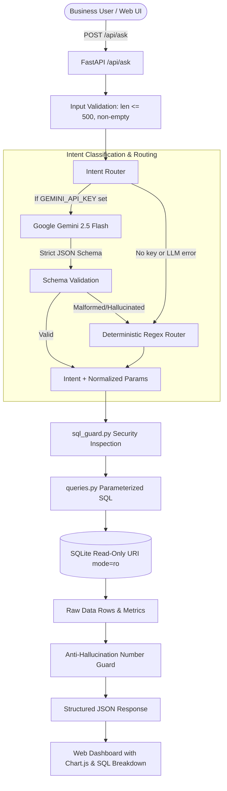

# Mini AI Business Intelligence Assistant

An enterprise-grade, deterministic AI-powered business intelligence assistant built for sales data analytics. Natural-language questions from business users are interpreted into strict intents, validated against formal schemas, and answered with 100% mathematically correct numbers computed via parameterized SQL queries executed against a read-only SQLite database.

---

## 🏛️ Architecture: Agentic Tool-Calling vs Free-Form SQL

Traditional text-to-SQL systems allow LLMs to write and execute arbitrary SQL. While flexible, this approach introduces severe security risks (SQL injection, statement chaining) and computational unreliability (hallucinated calculations, incorrect joins, subtle aggregation bugs).

Our **agentic tool-calling architecture** completely decouples natural language interpretation from database execution:



### Why this design is bulletproof:
1. **Zero Dynamic SQL Generation**: The LLM *never* generates SQL strings. Queries exist solely in code as audited, parameterized templates.
2. **Read-Only SQLite Connection**: Query execution uses `file:sales.db?mode=ro`, enforcing database engine-level read-only access.
3. **Defense-in-Depth `sql_guard.py`**: Any statement passed to the execution layer is verified to be a single `SELECT` statement with no semicolons, comments, or data-modifying keywords.
4. **Anti-Hallucination Verification**: Every number appearing in the natural-language answer headline is verified against the query result metrics. If any number diverges, the system discards the candidate summary and serves a guaranteed deterministic templated answer.
5. **Dual-Mode Resiliency**: If no API key is supplied or Gemini encounters network timeouts, the system automatically falls back to an internal deterministic regex/keyword router with zero loss of analytical capability.

---

## 📊 Business Definitions & Data Contracts

### Core Business Metric
$$\text{Revenue} = (\text{Quantity} \times \text{Unit Price}) - \text{Discount Amount}$$
- Computed **only** for valid records where `Status = 'Completed'`.
- `Discount_amount` is treated as the **total dollar discount** for the line item.

### Data Cleaning & Quarantine Rules
Source: `data/ai_bi_assistant_sales_data.csv` (51 rows, Jan–Jun 2026).
- **TXN0033 (`Status = 'Returned'`)**: Excluded from revenue analysis. Quarantined to `rejected_records`.
- **TXN0034 (`Quantity = 0`)**: Invalid transaction quantity ($\le 0$). Quarantined to `rejected_records`.
- **TXN0051 (`Unit_price` is blank)**: Missing price. Quarantined to `rejected_records` without guessing.
- **Generic Validation**: Automatically quarantines duplicate transaction IDs, negative prices/quantities/discounts, discounts exceeding line totals, bad dates, and unknown statuses.
- **Date Standardization**: Dates are parsed explicitly with `dayfirst=True` and stored as ISO `YYYY-MM-DD` with a derived `year_month` (`YYYY-MM`).

---

## 🚀 Supported Intents

| Intent | Description | Parameters | Example Question |
|---|---|---|---|
| `total_revenue` | Computes aggregate revenue, transactions, units, and AOV | `product`, `category`, `region`, `sales_channel`, `year_month` | *"What is our total revenue for 2026?"* |
| `top_product_by_revenue` | Ranks top 5 products by revenue and units sold | `region`, `year_month` | *"What are the top products by revenue?"* |
| `monthly_revenue_trend` | Jan–Jun 2026 revenue with MoM % change | None | *"Show me the monthly revenue trend and MoM growth"* |
| `top_region_by_sales` | Ranks all 4 regions by sales volume and market share | None | *"Which region has the highest sales?"* |
| `compare_months` | Computes revenue delta and % change between 2 months | `month_a`, `month_b` | *"Compare revenue between March and April 2026"* |
| `unsupported` | Polite guidance when a question is outside the scope | None | *"What is the weather in Tokyo?"* |

---

## 🛠️ Setup & Running

### Prerequisites
- Python 3.11+
- [uv](https://github.com/astral-sh/uv) or standard Python `venv`

### 1. Clone & Create Virtual Environment
```bash
cd mini_ai_bi_assistant
python -m venv .venv

# On Windows (PowerShell):
.venv\Scripts\Activate.ps1

# On Linux/macOS:
source .venv/bin/activate
```

### 2. Install Dependencies
```bash
pip install -r requirements.txt
```

### 3. Environment Variables (Optional)
Copy `.env.example` to `.env`:
```bash
cp .env.example .env
```
Add your Google Gemini API key:
```env
GEMINI_API_KEY=your_actual_gemini_api_key_here
```
> **Note**: If `GEMINI_API_KEY` is not provided, the assistant runs in fallback regex mode. All 5 example queries work out-of-the-box.

### 4. Run the Development Server
```bash
uvicorn app.main:app --reload --port 8000
```
- Web Dashboard: [http://localhost:8000](http://localhost:8000)
- OpenAPI Interactive Docs: [http://localhost:8000/docs](http://localhost:8000/docs)

### 5. Run the Test Suite
```bash
pytest -v tests/
```
All 24 automated tests will run against an isolated temporary database, validating data quarantine, pandas mathematical reconciliation, analytical queries, API contracts, prompt injection resistance, and fallback mechanisms.

---

## 📡 API Reference & Examples

### 1. Ask Question
`POST /api/ask`

**Request**:
```bash
curl -X POST http://localhost:8000/api/ask \
  -H "Content-Type: application/json" \
  -d '{"question": "What is our total revenue for 2026?"}'
```

**Response**:
```json
{
  "question": "What is our total revenue for 2026?",
  "intent": "total_revenue",
  "params": {},
  "answer": "Total revenue is $12,712.00 across 48 completed transactions (178 units sold, avg order value $264.83).",
  "supporting_data": [
    {
      "total_revenue": 12712.0,
      "transaction_count": 48,
      "total_quantity": 178,
      "average_order_value": 264.83
    }
  ],
  "sql": "SELECT \n    ROUND(COALESCE(SUM(revenue), 0.0), 2) AS total_revenue,\n    COUNT(*) AS transaction_count,\n    COALESCE(SUM(quantity), 0) AS total_quantity,\n    ROUND(COALESCE(AVG(revenue), 0.0), 2) AS average_order_value\nFROM sales\nWHERE status = 'Completed'",
  "mode": "fallback",
  "data_notes": "Analysis computed over 48 valid Completed transactions. 3 records excluded by quarantine: TXN0033 (returned), TXN0034 (zero quantity), TXN0051 (missing unit price)."
}
```

### 2. Compare Months
```bash
curl -X POST http://localhost:8000/api/ask \
  -H "Content-Type: application/json" \
  -d '{"question": "Compare revenue between March and April 2026"}'
```

**Response**:
```json
{
  "question": "Compare revenue between March and April 2026",
  "intent": "compare_months",
  "params": {
    "month_a": "2026-03",
    "month_b": "2026-04"
  },
  "answer": "Comparing 2026-03 ($1,861.00) vs 2026-04 ($2,481.00): revenue increased by $620.00 (+33.32%).",
  "supporting_data": [
    { "month": "2026-03", "total_revenue": 1861.0, "transaction_count": 8, "total_quantity": 31 },
    { "month": "2026-04", "total_revenue": 2481.0, "transaction_count": 8, "total_quantity": 27 }
  ],
  "mode": "fallback",
  "data_notes": "Analysis computed over 48 valid Completed transactions..."
}
```

### 3. Service Health & Audit
`GET /api/health`
```bash
curl http://localhost:8000/api/health
```
```json
{
  "status": "healthy",
  "database": "connected",
  "loaded_count": 48,
  "rejected_count": 3
}
```

`GET /api/data-quality`
```bash
curl http://localhost:8000/api/data-quality
```
```json
{
  "total_records": 51,
  "loaded_count": 48,
  "rejected_count": 3,
  "rejected_records": [
    { "transaction_id": "TXN0033", "reason": "Status is 'Returned' (only Completed orders are included in revenue)" },
    { "transaction_id": "TXN0034", "reason": "Invalid quantity: 0 (must be a positive integer > 0)" },
    { "transaction_id": "TXN0051", "reason": "Missing Unit_price (quarantined without guessing)" }
  ]
}
```

---

## 🔒 Security Measures

1. **Strict Intent Whitelisting**: The LLM only classifies questions into the 5 supported intents. It cannot define new intents or request unvalidated tables.
2. **Parameterized Queries**: All user parameters are bound using named parameters (`:product`, `:year_month`), eliminating SQL injection.
3. **`sql_guard.py` Defense-in-Depth**: Every executed SQL statement is inspected before execution to ensure:
   - It begins strictly with `SELECT`.
   - Contains no semicolons `;` (no chained statements).
   - Contains no SQL comments (`--`, `/*`).
   - Contains no data-modifying or admin keywords (`DROP`, `DELETE`, `UPDATE`, `INSERT`, `ATTACH`, `PRAGMA`, etc.).
4. **Read-Only SQLite Connection (`mode=ro`)**: SQLite enforces read-only access at the OS/filesystem level. Even if a statement bypassed `sql_guard`, SQLite rejects write operations.
5. **Anti-Hallucination Guard**: Natural-language summaries are cross-checked against actual query figures. If numbers diverge, the system replaces the summary with the verified template.

---

## 📁 Repository Structure

```
mini_ai_bi_assistant/
├── app/
│   ├── __init__.py
│   ├── main.py            # FastAPI app, static mounting, error handlers
│   ├── db.py              # SQLite connection management (read-write for init, mode=ro for queries)
│   ├── loader.py          # Data validation, cleaning, and SQLite loader
│   ├── schemas.py         # Pydantic models for API and intent contracts
│   ├── intents.py         # Whitelist of intents and parameter definitions
│   ├── queries.py         # Deterministic parameterized SQL query templates
│   ├── sql_guard.py       # Defense-in-depth SQL validator
│   ├── llm_client.py      # Google Gemini client wrapper with timeout & error handling
│   └── router.py          # Dual-engine intent router (LLM + Regex fallback)
├── static/
│   └── index.html         # Single-page UI with Chart.js, SQL viewer, data notes
├── data/
│   ├── ai_bi_assistant_sales_data.csv
│   └── sales.db
├── tests/
│   ├── __init__.py
│   ├── conftest.py        # Fixtures: in-memory / temporary test database, client
│   ├── test_loader.py     # Data quarantine, rejection reasons, pandas benchmark
│   ├── test_queries.py    # Query correctness, MoM calculations, region ranking
│   ├── test_api.py        # /api/ask, /api/health, /api/data-quality, error handling
│   └── test_security_and_fallback.py # sql_guard, injection rejection, hallucination guards
├── docs/
│   ├── AI_USAGE.md        # First-person reflection on AI development & debugging
│   └── VIVA_CHEAT_SHEET.md # 1-page architecture review & 8 interview Q&As
├── .env.example
├── .gitignore
├── requirements.txt
└── README.md
```
